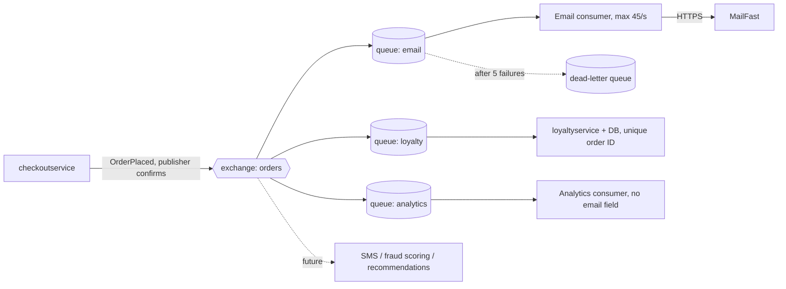

# ADR-0002: Publish an "order placed" event to RabbitMQ and run post-order actions as independent consumers

- **Status:** Proposed
- **Date:** 2026-10-27
- **Deciders:** Pasin Thanyakasikol (architect); to be approved by the architecture review board

> Based on the AI draft `exercise/outputs/2b-adr.md`, edited by the architect. Changes are listed in `exercise/02-write-adr.en.md`.

## Context and problem

Requirement R-12 (`docs/scenario.md`): after an order is placed, Online Boutique must (1) send the confirmation email through **MailFast** (replaces the mock `emailservice` logic), (2) award loyalty points through a new `loyaltyservice`, and (3) record an "order placed" analytics event. Marketing expects more post-order actions next year (SMS, fraud scoring, a recommendations update).

**Today** (`system/online-boutique/src/checkoutservice/main.go`, `PlaceOrder`): `chargeCard` (`paymentservice`), `shipOrder` (`shippingservice`), `emptyUserCart`, then `sendOrderConfirmation` (`emailservice`) run in sequence as synchronous gRPC calls on the request path. An email failure is only logged (`log.Warnf`) and the order still succeeds. Each downstream service has its own address/connection field wired with `mustMapEnv`/`mustConnGRPC`, so every new action today means another field, connection and call inside `PlaceOrder`.

**Facts from `docs/scenario.md`:**

| Topic | Fact |
|---|---|
| Checkout latency | p95 of `PlaceOrder` ≤ 500 ms (today approximately 300 ms) |
| Peak load | 200 orders/s during the 11.11 sale |
| MailFast | p95 1.5 s, p99 8 s; fails approximately 0.5 % of calls; rate limit 50 emails/s |
| Loyalty points | within 1 minute of the order, exactly once |
| Availability | an order must never fail because email, loyalty or analytics is down |
| Team | 4 developers; strong in Go and gRPC; two have used RabbitMQ |
| Operations | Kubernetes; prefers open-source, self-hosted components over cloud-only managed services |

**Why the current pattern does not extend:**
- MailFast's p95 (1.5 s) alone is three times the whole 500 ms budget; p99 is 8 s.
- At 200 orders/s and 50 emails/s, **150 emails/s** cannot be sent as they are produced. This cannot be solved by any design that sends email at order time; it can only be queued.
- The remaining budget for new synchronous work is approximately 200 ms (500 − 300).
- Online Boutique has **no order database**: `checkoutservice` is stateless, so there is nowhere today to store an event for later re-sending.

## Decision drivers

1. **Availability:** an order must never fail because email, loyalty or analytics is down.
2. **Performance:** `PlaceOrder` p95 ≤ 500 ms at 200 orders/s.
3. **Correctness:** loyalty points within 1 minute, exactly once.
4. **Modifiability:** new post-order actions are expected next year and should not require changing `checkoutservice`.
5. **Fit with team and operations:** Go/gRPC skills, two RabbitMQ users, Kubernetes, open-source and self-hosted.
6. **Cost/complexity:** a team of 4; keep the number of new moving parts small.

## Considered options

1. Extend the current pattern: `checkoutservice` calls MailFast, `loyaltyservice` and analytics synchronously over gRPC
2. Fire-and-forget goroutines in `checkoutservice` (timeouts and retries, no broker)
3. `checkoutservice` publishes one `OrderPlaced` event to a **self-hosted RabbitMQ**; each action is a consumer with its own queue
4. `checkoutservice` publishes to a **self-hosted Apache Kafka** topic; each action is a consumer group
5. A cloud-managed messaging service

### Pros and cons of the options

| Option | Pros | Cons |
|---|---|---|
| 1. Synchronous gRPC | Same pattern as today; team knows gRPC; simplest | MailFast p95 1.5 s breaks the 500 ms budget; 50/s limit is exceeded at 200 orders/s; every new action edits `checkoutservice` |
| 2. Fire-and-forget goroutines | No new infrastructure; checkout stays fast | Pending work lost when a pod restarts or is rescaled (normal during a sale); no buffer for the 150/s email excess; retries and dedup live in `checkoutservice`; one code change per action |
| 3. RabbitMQ + consumers | Takes MailFast off the request path; queues absorb the email excess; a consumer outage doesn't affect orders; new actions are new queues bound to the exchange; open-source, self-hosted; two developers already know it; per-consumer rate limiting is simple (prefetch + rate limiter) | New stateful component to run; at-least-once delivery, so consumers must deduplicate; the broker is a new dependency on the checkout path |
| 4. Kafka + consumer groups | Open-source, self-hosted; event log can be replayed (useful for analytics and for a future recommendations update) | No team experience; heavier to operate (cluster, partitions) for 200 events/s; per-consumer rate limiting and dead-lettering must be built by hand |
| 5. Managed cloud messaging | Least operating work | Conflicts with the stated preference for self-hosted, open-source components; ties the system to one cloud |

## Decision

Choose **Option 3 (RabbitMQ)**. Kafka (Option 4) is the runner-up: its replay ability is attractive, but at 200 events/s it brings operating cost and a learning curve the 4-person team does not need before 11.11.

1. **Publish.** After `emptyUserCart`, `checkoutservice` publishes one `OrderPlaced` event (order ID, user ID, email, items, total) to a durable **topic exchange** `orders`, with **publisher confirms** and a **100 ms timeout**. This replaces the `sendOrderConfirmation` gRPC call.
2. **One queue per action.** Each consumer has its own durable **quorum queue** bound to the exchange, so a backlog in one (email) never delays another (loyalty):
   - `email` → **email consumer** (adapter around MailFast). It sends at most **45 emails/s** (headroom under the 50/s limit) and retries with backoff. After 5 attempts the message goes to a dead-letter queue. The mock `emailservice` is retired.
   - `loyalty` → **`loyaltyservice`**, written in Go. It awards points in one database transaction that also inserts the order ID into a table with a **unique constraint**. A redelivered event hits the constraint and is acknowledged without awarding again. Delivery is at-least-once; the effect is exactly once.
   - `analytics` → **analytics consumer**. It receives the event **without the email address** (the publisher sends a separate, reduced message or the consumer strips it) so no personal data reaches marketing systems.
3. **If publishing fails** (the broker is down or the confirm times out), the order still succeeds (availability driver #1). `checkoutservice` keeps the event in a bounded in-memory retry buffer, retries in the background, logs the order ID and raises the `orderplaced_publish_failures` metric. This leaves a small loss window (a pod dying while holding unsent events). I accept that for this release because RabbitMQ runs as a 3-node quorum cluster. A durable outbox is deferred until `checkoutservice` gets storage (see Open questions).

## Consequences

- **Positive:** `PlaceOrder` only adds one broker publish (target < 20 ms p95) and drops the old email gRPC call, so it stays well inside 500 ms and is no longer tied to MailFast's 1.5 s / 8 s (performance).
- **Positive:** MailFast, `loyaltyservice` or analytics being down cannot fail an order; their events wait in their own queues (availability).
- **Positive:** loyalty points are awarded once even when events are redelivered (correctness).
- **Positive:** a new action is a new queue and consumer, with no change to `checkoutservice` (modifiability).
- **Positive:** open-source, self-hosted, and known by two developers (cost, operability).
- **Negative:** confirmation emails will be late during the sale. If the 200 orders/s peak lasted 1 hour (an assumption; see Open questions), 720,000 orders would leave a backlog of approximately 558,000 emails, which takes approximately 3.4 hours to clear at 45/s (user-perceived quality).
- **Negative:** RabbitMQ is a new stateful cluster to deploy, secure, monitor and upgrade (operability, cost).
- **Negative:** `loyaltyservice` needs its own database (cost, operability).
- **Risks and mitigations:**
  - *Lost events while the broker is down:* quorum queues on 3 nodes, publisher confirms, a background retry buffer, an alert on `orderplaced_publish_failures`. The residual risk is accepted (see Decision, point 3).
  - *Loyalty misses its 1-minute target:* the separate `loyalty` queue keeps it out of the email backlog. Alert when the oldest message in `loyalty` is older than 30 s.
  - *Duplicate emails on retry:* MailFast idempotency is unknown (see Open questions). Until it is known, the email consumer records each order ID it has sent.
  - *Poison messages:* dead-letter queues with alerting.
  - *Only two developers know RabbitMQ:* pairing and a one-week spike before implementation.

## Validation

- Load test at 200 orders/s for 30 minutes with a MailFast stub (p95 1.5 s, p99 8 s, 0.5 % failures, 50/s limit). Pass if `PlaceOrder` p95 ≤ 500 ms, 0 failed orders, and the stub never receives more than 50 requests/s.
- Chaos test: kill each consumer, one RabbitMQ node, and then the whole broker. Pass if 0 orders fail and the queues drain after recovery.
- Redeliver the same `OrderPlaced` event 10 times. Pass if points are awarded exactly once and the 99th-percentile time to award points is under 60 s at peak.
- Review this ADR after 11.11, using the email queue depth, the publish-failure count and the loyalty lag.

## Open questions

- How long does the 11.11 peak last? This sets the size of the email backlog and of RabbitMQ's disks.
- What email delay does the business accept? Can MailFast's 50/s limit be raised for the sale?
- Does MailFast support idempotency keys?
- May `checkoutservice` get storage for a durable outbox (to close the loss window)?
- Where does the analytics event go, and how long is it kept?
- Who operates RabbitMQ in production (the team or a platform team)?
