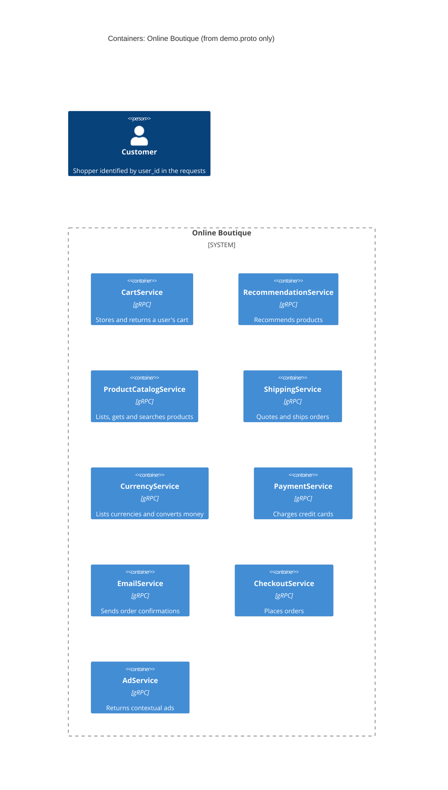

# Task 1, run A: Recovered architecture

## 1. Agent

Claude Code (Anthropic), model Claude Sonnet 5.5 (`claude-sonnet-5-5`).

## 2. Files read

- `prompts/1-recover-architecture.md` (the task file)
- `system/online-boutique/protos/demo.proto` (the only evidence)

## 3. Containers table

`demo.proto` defines gRPC services (`service` blocks) in `package hipstershop`. A `service` block shows that a service exists and what its API is. It does not show the language, the deployment unit or any data store, so technology is "Not evidenced in the provided files" except for the protocol.

| Container | Technology / language | Responsibility | Evidence |
|---|---|---|---|
| CartService | Not evidenced in the provided files (API: gRPC/protobuf) | Stores and returns a user's cart: `AddItem`, `GetCart`, `EmptyCart` | `system/online-boutique/protos/demo.proto` (`service CartService`) |
| RecommendationService | Not evidenced in the provided files (API: gRPC/protobuf) | Returns recommended product ids for a user: `ListRecommendations` | `system/online-boutique/protos/demo.proto` (`service RecommendationService`) |
| ProductCatalogService | Not evidenced in the provided files (API: gRPC/protobuf) | Lists, gets and searches products: `ListProducts`, `GetProduct`, `SearchProducts` | `system/online-boutique/protos/demo.proto` (`service ProductCatalogService`) |
| ShippingService | Not evidenced in the provided files (API: gRPC/protobuf) | Quotes shipping cost and ships an order: `GetQuote`, `ShipOrder` | `system/online-boutique/protos/demo.proto` (`service ShippingService`) |
| CurrencyService | Not evidenced in the provided files (API: gRPC/protobuf) | Lists supported currencies and converts `Money`: `GetSupportedCurrencies`, `Convert` | `system/online-boutique/protos/demo.proto` (`service CurrencyService`) |
| PaymentService | Not evidenced in the provided files (API: gRPC/protobuf) | Charges a credit card: `Charge` | `system/online-boutique/protos/demo.proto` (`service PaymentService`) |
| EmailService | Not evidenced in the provided files (API: gRPC/protobuf) | Sends an order confirmation: `SendOrderConfirmation` | `system/online-boutique/protos/demo.proto` (`service EmailService`) |
| CheckoutService | Not evidenced in the provided files (API: gRPC/protobuf) | Places an order: `PlaceOrder` | `system/online-boutique/protos/demo.proto` (`service CheckoutService`) |
| AdService | Not evidenced in the provided files (API: gRPC/protobuf) | Returns ads for page context keywords: `GetAds` | `system/online-boutique/protos/demo.proto` (`service AdService`) |

No data stores, message brokers or web frontend are defined in this file.

## 4. Dependencies table

| Caller → callee | Protocol | Evidence |
|---|---|---|
| None can be proven from this evidence | n/a | `system/online-boutique/protos/demo.proto` only declares service interfaces. It has no caller, address or environment variable that says which service calls which. |

Plausible dependencies suggested by message shapes are listed under Gaps as **[Inferred]**, not here.

## 5. Mermaid diagram

The diagram has no `Rel` lines because the dependencies table is empty. The `Customer` is shown only because `user_id` fields exist in the requests; the file does not show how the customer reaches the system.

## 6. Gaps

| Gap | Why it matters | Extra file that would settle it |
|---|---|---|
| Caller → callee relationships | `demo.proto` does not show who calls whom. **[Inferred]**: `PlaceOrderRequest`/`OrderResult` reuse `Address`, `CreditCardInfo`, `CartItem` and `Money`, which suggests `CheckoutService` may use cart, shipping, payment, email, currency and catalog services. This is not proven. | `system/online-boutique/kubernetes-manifests/checkoutservice.yaml` (`*_SERVICE_ADDR` env vars), or the service source code |
| Web frontend and how the Customer reaches the system | No frontend service or HTTP interface is defined. | `system/online-boutique/kubernetes-manifests/frontend.yaml` |
| Implementation language/technology of each service | Only the API is defined. `option go_package` concerns generated Go stubs, not the service's language. | Each service's source folder or Dockerfile |
| Data stores | No database or cache appears (for example where `CartService` keeps carts). | `system/online-boutique/kubernetes-manifests/cartservice.yaml` and the cart service source |
| Message brokers / async messaging | None appears in the proto. | Kubernetes manifests |
| External systems (payment provider, email/SMTP, etc.) | Not shown; `PaymentService` and `EmailService` may or may not call outside systems. | Source code of those services |
| Services that exist outside gRPC | Any container without a gRPC API (frontend, load generator, databases) cannot appear in this file. | `system/online-boutique/kubernetes-manifests/` |
