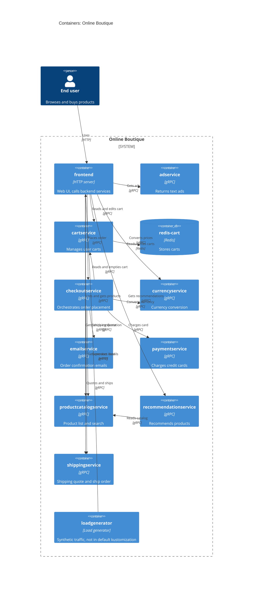

# Task 1 – Recovered architecture (run B)

## 1. Agent

Claude Code, model Claude Sonnet 5.5 (`claude-sonnet-5-5`).

## 2. Files read

- `prompts/1-recover-architecture.md` (task file)
- `system/online-boutique/protos/demo.proto`
- `system/online-boutique/kubernetes-manifests/README.md`
- `system/online-boutique/kubernetes-manifests/adservice.yaml`
- `system/online-boutique/kubernetes-manifests/cartservice.yaml` (also defines `redis-cart`)
- `system/online-boutique/kubernetes-manifests/checkoutservice.yaml`
- `system/online-boutique/kubernetes-manifests/currencyservice.yaml`
- `system/online-boutique/kubernetes-manifests/emailservice.yaml`
- `system/online-boutique/kubernetes-manifests/frontend.yaml`
- `system/online-boutique/kubernetes-manifests/kustomization.yaml`
- `system/online-boutique/kubernetes-manifests/loadgenerator.yaml`
- `system/online-boutique/kubernetes-manifests/paymentservice.yaml`
- `system/online-boutique/kubernetes-manifests/productcatalogservice.yaml`
- `system/online-boutique/kubernetes-manifests/recommendationservice.yaml`
- `system/online-boutique/kubernetes-manifests/shippingservice.yaml`

## 3. Containers table

Implementation languages are **not evidenced** in the provided files (the manifests only give image names such as `image: adservice`), so the technology column shows only what the files show.

| Container | Technology | Responsibility | Evidence |
|---|---|---|---|
| frontend | HTTP server (language not evidenced); gRPC client | Serves the web UI on port 8080 (exposed on 80); calls the backend services | `kubernetes-manifests/frontend.yaml` (Deployment `frontend`, `httpGet /_healthz`, Service `frontend-external` type `LoadBalancer`) |
| adservice | gRPC server, port 9555 | Returns text ads for given context keys | `protos/demo.proto` (`service AdService { GetAds }`); `kubernetes-manifests/adservice.yaml` (port 9555, Service port name `grpc`) |
| cartservice | gRPC server, port 7070 | Add item / get / empty a user's cart; keeps carts in Redis | `protos/demo.proto` (`service CartService`); `kubernetes-manifests/cartservice.yaml` (port 7070, `REDIS_ADDR`) |
| redis-cart | Redis (`image: redis:alpine`), port 6379, `emptyDir` volume | Data store for carts | `kubernetes-manifests/cartservice.yaml` (Deployment/Service `redis-cart`, `volumes: redis-data emptyDir`) |
| checkoutservice | gRPC server, port 5050 | Orchestrates `PlaceOrder`: cart, catalog, currency, shipping, payment, email | `protos/demo.proto` (`service CheckoutService`); `kubernetes-manifests/checkoutservice.yaml` (`*_SERVICE_ADDR` env vars) |
| currencyservice | gRPC server, port 7000 | Lists supported currencies and converts `Money` | `protos/demo.proto` (`service CurrencyService`); `kubernetes-manifests/currencyservice.yaml` (port 7000) |
| emailservice | gRPC server, container port 8080, Service port 5000 | Sends order confirmation emails | `protos/demo.proto` (`service EmailService { SendOrderConfirmation }`); `kubernetes-manifests/emailservice.yaml` (port 5000 → 8080) |
| paymentservice | gRPC server, port 50051 | Charges a credit card, returns a transaction id | `protos/demo.proto` (`service PaymentService { Charge }`); `kubernetes-manifests/paymentservice.yaml` (port 50051) |
| productcatalogservice | gRPC server, port 3550 | Lists, gets and searches products | `protos/demo.proto` (`service ProductCatalogService`); `kubernetes-manifests/productcatalogservice.yaml` (port 3550) |
| recommendationservice | gRPC server, port 8080 | Returns recommended product ids | `protos/demo.proto` (`service RecommendationService`); `kubernetes-manifests/recommendationservice.yaml` (port 8080) |
| shippingservice | gRPC server, port 50051 | Shipping quote and ship order (tracking id) | `protos/demo.proto` (`service ShippingService`); `kubernetes-manifests/shippingservice.yaml` (port 50051) |
| loadgenerator | Load generator (tool not evidenced) | Generates synthetic user traffic against the frontend. Not in the default kustomization (commented out). | `kubernetes-manifests/loadgenerator.yaml` (`USERS`, `RATE`, `FRONTEND_ADDR`); `kubernetes-manifests/kustomization.yaml` (`# - loadgenerator.yaml`) |

## 4. Dependencies table

Protocol note: gRPC is concluded from `protos/demo.proto` (services/RPCs), the Service port name `grpc` and the `grpc:` probes in each manifest. The caller's own protocol is not shown directly by the manifests, so each gRPC row is only as strong as the address env var plus the callee's gRPC service.

| Caller → Callee | Protocol | Evidence |
|---|---|---|
| End user → frontend | HTTP | `kubernetes-manifests/frontend.yaml` (Service `frontend-external`, `type: LoadBalancer`, port 80 → 8080; `httpGet`) |
| loadgenerator → frontend | HTTP | `kubernetes-manifests/loadgenerator.yaml` (`FRONTEND_ADDR=frontend:80`; init container uses `wget http://${FRONTEND_ADDR}`) |
| frontend → productcatalogservice | gRPC | `frontend.yaml` (`PRODUCT_CATALOG_SERVICE_ADDR=productcatalogservice:3550`) |
| frontend → currencyservice | gRPC | `frontend.yaml` (`CURRENCY_SERVICE_ADDR=currencyservice:7000`) |
| frontend → cartservice | gRPC | `frontend.yaml` (`CART_SERVICE_ADDR=cartservice:7070`) |
| frontend → recommendationservice | gRPC | `frontend.yaml` (`RECOMMENDATION_SERVICE_ADDR=recommendationservice:8080`) |
| frontend → shippingservice | gRPC | `frontend.yaml` (`SHIPPING_SERVICE_ADDR=shippingservice:50051`) |
| frontend → checkoutservice | gRPC | `frontend.yaml` (`CHECKOUT_SERVICE_ADDR=checkoutservice:5050`) |
| frontend → adservice | gRPC | `frontend.yaml` (`AD_SERVICE_ADDR=adservice:9555`) |
| checkoutservice → productcatalogservice | gRPC | `checkoutservice.yaml` (`PRODUCT_CATALOG_SERVICE_ADDR=productcatalogservice:3550`) |
| checkoutservice → shippingservice | gRPC | `checkoutservice.yaml` (`SHIPPING_SERVICE_ADDR=shippingservice:50051`) |
| checkoutservice → paymentservice | gRPC | `checkoutservice.yaml` (`PAYMENT_SERVICE_ADDR=paymentservice:50051`) |
| checkoutservice → emailservice | gRPC | `checkoutservice.yaml` (`EMAIL_SERVICE_ADDR=emailservice:5000`) |
| checkoutservice → currencyservice | gRPC | `checkoutservice.yaml` (`CURRENCY_SERVICE_ADDR=currencyservice:7000`) |
| checkoutservice → cartservice | gRPC | `checkoutservice.yaml` (`CART_SERVICE_ADDR=cartservice:7070`) |
| recommendationservice → productcatalogservice | gRPC | `recommendationservice.yaml` (`PRODUCT_CATALOG_SERVICE_ADDR=productcatalogservice:3550`) |
| cartservice → redis-cart | Redis (TCP) | `cartservice.yaml` (`REDIS_ADDR=redis-cart:6379`; Service `redis-cart` port name `tcp-redis`) |

## 5. Mermaid diagram

## 6. Gaps

| Gap | Why it is open | Extra file that would settle it |
|---|---|---|
| `shoppingassistantservice` | `frontend.yaml` sets `SHOPPING_ASSISTANT_SERVICE_ADDR=shoppingassistantservice:80`, but no manifest in the folder defines it. The `kustomization.yaml` only mentions a `shopping-assistant` component in a comment. Not in the diagram. | `kustomize/components/shopping-assistant/*` or the source of `frontend` |
| Which service actually calls which RPC | `demo.proto` defines services and RPCs but not callers. The env vars only show configured addresses, not that calls are made or which RPCs are used. | Source code of `frontend` and `checkoutservice` |
| Protocol of the callers (gRPC vs other) | gRPC is inferred from the callee's proto, `grpc:` probes and Service port names. The callers' client code is not in evidence. | Source code of the clients |
| Implementation languages / frameworks | Only image names appear in the manifests. | `src/*/` (Dockerfiles, build files) or `skaffold.yaml` |
| Product data store | `productcatalogservice` has no data-store env var in its manifest; where products come from is not evidenced. | `src/productcatalogservice/` |
| External systems (email provider, payment gateway, shipping carrier, ad source) | No external address is configured in the provided manifests, so no `System_Ext` is drawn. Whether these services call anything outside the cluster is not evidenced. | Source code of `emailservice`, `paymentservice`, `shippingservice`, `adservice` |
| `loadgenerator` in the deployed system | It has a manifest but is commented out of `kustomization.yaml` ("the loadgenerator module inside skaffold.yaml will be used"), so whether it runs in a given deployment is not evidenced. | `skaffold.yaml` |
| Runtime sidecars / service mesh | Annotations `sidecar.istio.io/rewriteAppHTTPProbers` appear in `frontend.yaml` and `loadgenerator.yaml`, but whether Istio is deployed is not evidenced. | `istio-manifests/` or deployment docs |
| Alternative back ends (Memorystore, AlloyDB, Spanner) | Only mentioned as commented-out kustomize components; not shown as part of the system. | `kustomize/components/*` |
| Image tags / deployability | `kubernetes-manifests/README.md` says these manifests are not directly deployable (images are filled in by `skaffold`). | `skaffold.yaml`, `release/` manifests |
