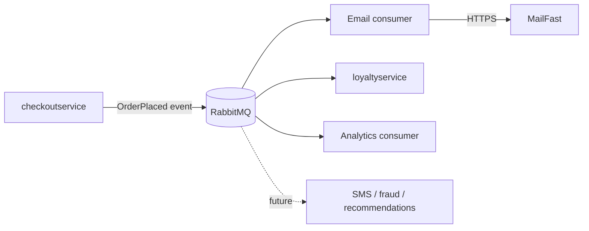

Agent: Claude Code subagent, model Claude Sonnet 5.5 (claude-sonnet-5-5)

# ADR-0002: Publish an "order placed" event to RabbitMQ and run post-order actions as independent consumers

- **Status:** Proposed
- **Date:** 2026-10-27
- **Deciders:** Not given in the provided files (see Open questions)

## Context and problem

Requirement R-12 (`docs/scenario.md`): after an order is placed, Online Boutique must (1) send the confirmation email through **MailFast** (replaces the mock `emailservice` logic), (2) award loyalty points through a new `loyaltyservice`, and (3) record an "order placed" analytics event. Marketing expects more post-order actions next year (SMS, fraud scoring, a recommendations update).

**Today** (`system/online-boutique/src/checkoutservice/main.go`, `PlaceOrder`): the order is processed in sequence: `chargeCard` (`paymentservice`), `shipOrder` (`shippingservice`), `emptyUserCart`, then `sendOrderConfirmation` (`emailservice`), all synchronous gRPC calls on the request path. An email failure is only logged with `log.Warnf` and the order still succeeds. `checkoutService` holds one gRPC connection field per downstream service (`emailSvcAddr`/`emailSvcConn`, etc.), wired with `mustMapEnv` and `mustConnGRPC`, so each new post-order action would add another address, connection and call inside `PlaceOrder`. `sendOrderConfirmation` passes the request `ctx` straight through; no separate timeout for it is visible in `main.go`.

**Facts from `docs/scenario.md`:**

| Topic | Fact |
|---|---|
| Checkout latency | p95 of `PlaceOrder` must stay ≤ 500 ms (today approximately 300 ms) |
| Peak load | 200 orders/s during the 11.11 sale |
| MailFast | p95 1.5 s, p99 8 s; fails approximately 0.5 % of calls; rate limit 50 emails/s |
| Loyalty points | within 1 minute of the order, exactly once |
| Availability | an order must never fail because email, loyalty or analytics is down |
| Team | 4 developers; strong in Go and gRPC; two have used RabbitMQ |
| Operations | runs on Kubernetes; prefers open-source, self-hosted components over cloud-only managed services |

**Why the current pattern does not extend:**
- MailFast p95 (1.5 s) alone exceeds the whole 500 ms p95 budget if called synchronously inside `PlaceOrder`; p99 is 8 s.
- 200 orders/s against a 50 emails/s rate limit means that, at peak, 150 emails/s more are produced than MailFast accepts. Synchronous calls would be rejected or would pile up as blocked checkout requests.
- Loyalty needs exactly-once awarding, but a synchronous call with retries can double-award.
- Each new action (SMS, fraud scoring, recommendations) would again change `checkoutservice`.

## Decision drivers

1. **Availability:** an order must never fail because email, loyalty or analytics is down.
2. **Performance:** `PlaceOrder` p95 ≤ 500 ms at 200 orders/s; the slow MailFast call must stay off the request path.
3. **Correctness:** loyalty points within 1 minute, exactly once.
4. **Modifiability:** more post-order actions expected next year; adding one should not require changing `checkoutservice`.
5. **Fit with team and operations:** Go/gRPC skills, two RabbitMQ users, Kubernetes, open-source and self-hosted preferred.
6. **Cost/complexity:** 4 developers; keep the number of new moving parts small.

## Considered options

1. Extend the current pattern: `checkoutservice` calls MailFast, `loyaltyservice` and analytics synchronously over gRPC inside `PlaceOrder`
2. Keep calls from `checkoutservice` but fire-and-forget (goroutines with timeouts and retries, no broker)
3. `checkoutservice` publishes one `OrderPlaced` event to a self-hosted RabbitMQ; email, loyalty and analytics are separate consumers with their own queues
4. A cloud-managed messaging service (e.g. a managed pub/sub or streaming service)

### Pros and cons of the options

| Option | Pros | Cons |
|---|---|---|
| 1. Synchronous gRPC | Same pattern as today (`main.go`); team knows gRPC; simplest to build | MailFast p95 1.5 s breaks the 500 ms budget; the 50 emails/s limit is hit at 200 orders/s; failures can become order failures unless every call is wrapped like the email one; every new action edits `checkoutservice` |
| 2. Fire-and-forget goroutines | No new infrastructure; checkout returns quickly | Pending work is lost if the pod restarts; no buffering to smooth the 200 vs 50 /s mismatch; retry and exactly-once logic lives inside `checkoutservice`; still one code change per new action |
| 3. RabbitMQ event + consumers | Removes MailFast latency from checkout; queue buffers the burst above the 50/s limit; a consumer outage does not affect orders and messages wait in its queue; new actions (SMS, fraud, recommendations) are new consumers with no `checkoutservice` change; open-source and self-hostable on Kubernetes; two developers have used RabbitMQ | New stateful component to run and monitor; delivery is at-least-once, so `loyaltyservice` must deduplicate; the broker becomes a new dependency of checkout (publish can fail); eventual consistency (email and points arrive after the order) |
| 4. Managed cloud messaging | Less operating work | Conflicts with the stated preference for open-source, self-hosted over cloud-only managed services; no team experience evidenced |

## Decision

Choose **Option 3**. After the order is charged and shipped, `checkoutservice` publishes a single `OrderPlaced` event (order ID, user, email, items, totals) to a **self-hosted RabbitMQ** on Kubernetes, and returns to the user without waiting for any post-order action. Each action has its own durable queue and consumer:

- **Email consumer** (adapter around MailFast, replacing the mock `emailservice` logic): sends at a rate capped below 50/s, retries on failure.
- **`loyaltyservice`**: awards points idempotently, using the order ID as the deduplication key, so redelivery cannot double-award.
- **Analytics consumer**: records the "order placed" event.

Publishing is best-effort from the order's point of view: a failed publish is logged and does not fail `PlaceOrder`, mirroring how a failed email is handled today in `main.go`. How to avoid losing the event in that case is an open question.

This best meets the drivers: it protects availability and the latency budget (the only synchronous addition is one broker publish), absorbs the MailFast rate limit and failures through queuing and retry, enables exactly-once effect via idempotent consumers, makes the next post-order actions additive, and stays within the team's skills and the self-hosted, open-source preference.

## Consequences

- **Positive:** `PlaceOrder` latency is no longer tied to MailFast's p95 1.5 s / p99 8 s (performance).
- **Positive:** failure of MailFast, `loyaltyservice` or analytics cannot fail an order; events wait in queues (availability).
- **Positive:** queues smooth the burst between 200 orders/s and the 50 emails/s limit (performance, availability).
- **Positive:** new post-order actions are added as consumers without editing `checkoutservice` (modifiability).
- **Positive:** open-source, self-hosted, and known by part of the team (cost, operability).
- **Negative:** a new stateful component to deploy, secure, monitor and upgrade (operability, cost).
- **Negative:** emails and points are eventually consistent; confirmation email delay grows during peaks (user-perceived quality). The acceptable email delay is not given.
- **Negative:** at-least-once delivery forces idempotent consumers and dead-letter handling (modifiability, correctness effort).
- **Risks and mitigations:**
  - Broker unavailable at publish time means lost events. Mitigate with publisher confirms and a bounded retry in `checkoutservice`, and consider an outbox pattern (needs storage in `checkoutservice`, not evidenced in the provided files).
  - Email backlog during 11.11 (150/s excess if peak lasts). Mitigate with a rate-limited consumer and queue-depth alerts; size depends on peak duration (open question).
  - RabbitMQ becomes a single point of failure. Mitigate with a clustered/mirrored deployment on Kubernetes.
  - Only two of four developers know RabbitMQ. Mitigate with pairing and a short spike.

## Validation

- Load test at 200 orders/s (e.g. with the `loadgenerator`) and confirm `PlaceOrder` p95 ≤ 500 ms with the publish enabled, and with MailFast simulated at p95 1.5 s, p99 8 s, 0.5 % failures.
- Chaos test: stop each consumer and the MailFast stub in turn; confirm zero failed orders and that queues drain after recovery.
- Redeliver the same `OrderPlaced` message several times and confirm loyalty points are awarded once; confirm points appear within 1 minute at peak.
- Watch email queue depth and age during a peak simulation; review this ADR after the 11.11 sale.

## Open questions

- Who are the deciders / approvers? Not given in the provided files.
- How long does the 11.11 peak at 200 orders/s last, and how many emails may queue? This sets backlog size and whether MailFast's 50/s limit can ever be met in time.
- How late may a confirmation email be? Not given.
- Does `checkoutservice` have (or may it get) storage for an outbox? Not evidenced in the provided files.
- How is `OrderPlaced` published if RabbitMQ is down: drop, retry, or block? Business tolerance for a lost event (e.g. missing points) is not given.
- What does the analytics event contain and where does it go (system, retention, privacy of user email)? Not given.
- Does MailFast have an idempotency feature to prevent duplicate emails on retry? Not given.
- RabbitMQ sizing, availability target and who runs it. Not given.
- Contract and payload format of the event, and how `emailservice` is retired (the `EMAIL_SERVICE_ADDR` wiring in `main.go` would need changing). Not decided here.
